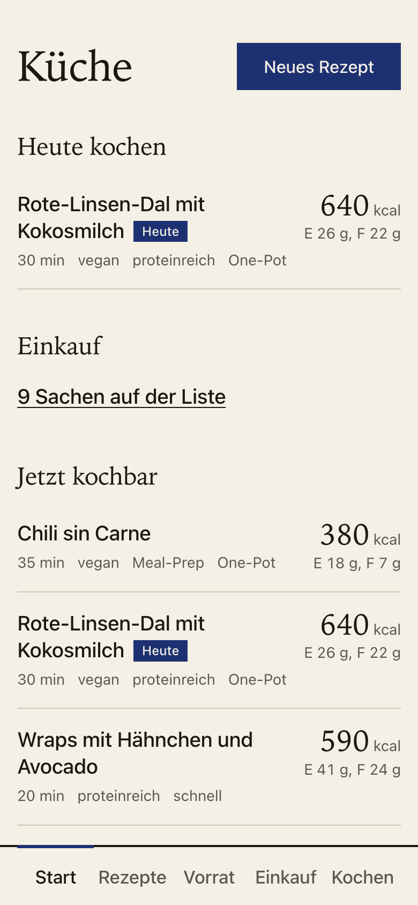
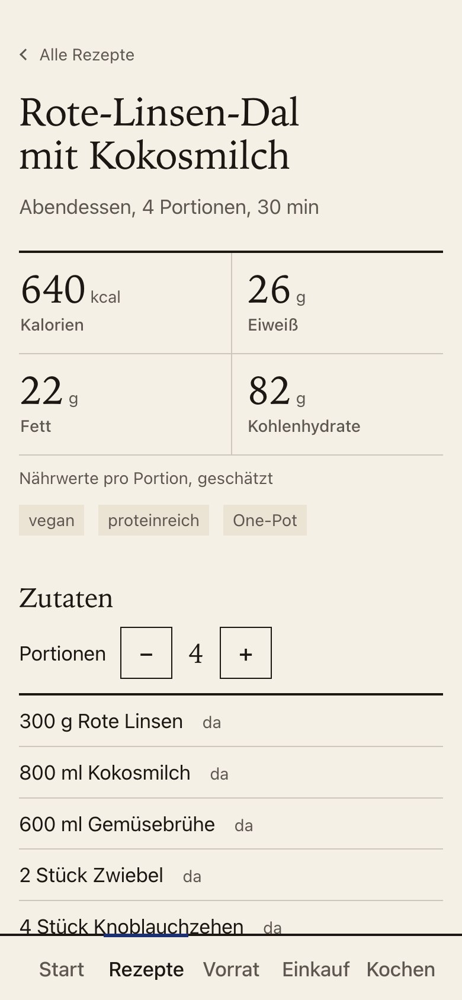
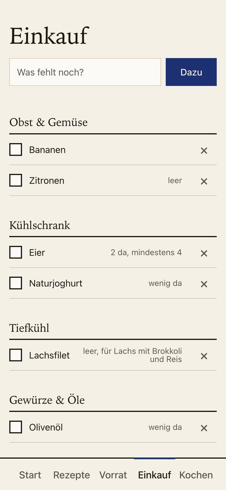
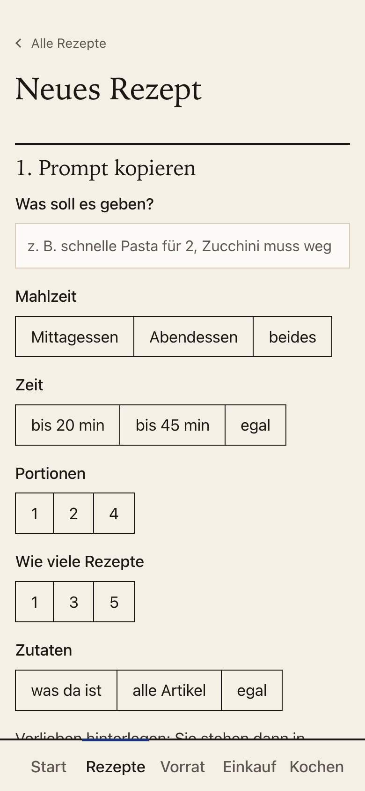
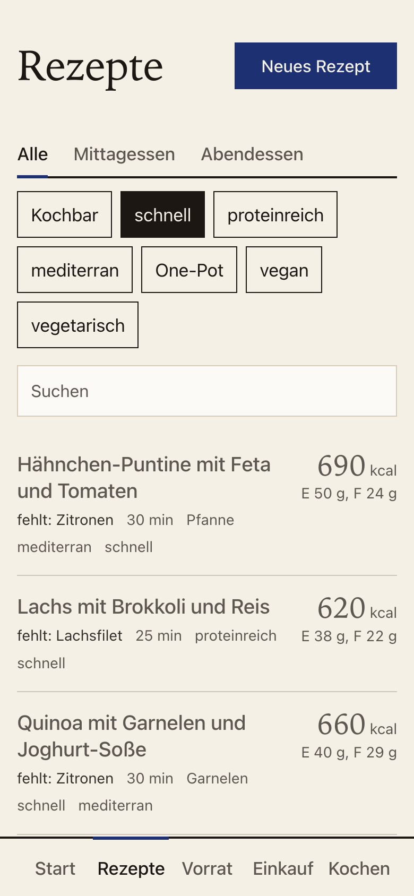
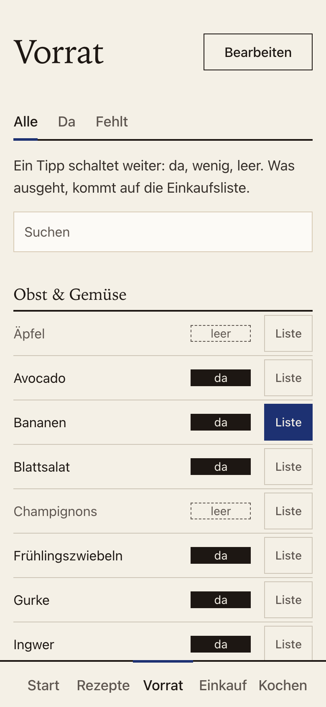
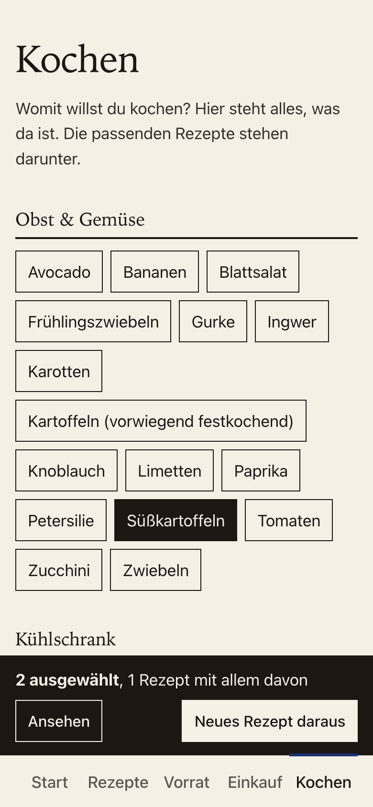
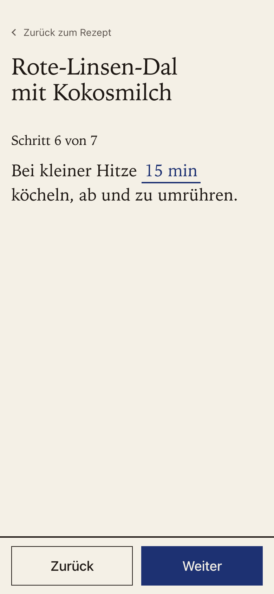
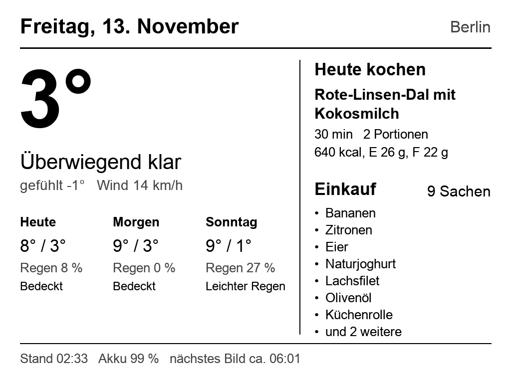
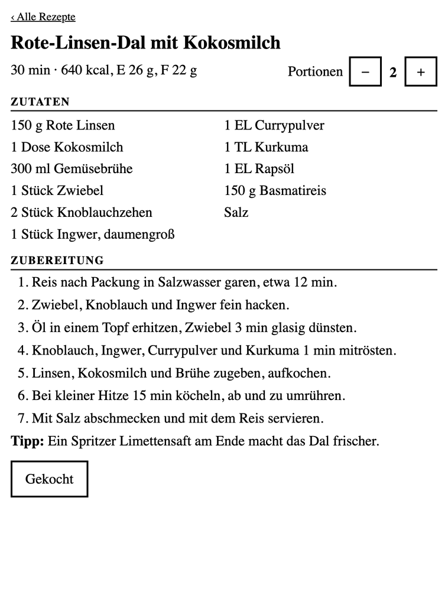

# PiChef

[](https://github.com/Auktoriator/PiChef/actions/workflows/test.yml)
[](https://github.com/Auktoriator/PiChef/releases)
[](LICENSE)

*A small German-language kitchen app for your Raspberry Pi: recipes, pantry, shopping list and a cooking mode,
made for the phone. No account, no cloud. An old Kindle can serve as an optional kitchen display.*

Eine kleine Küchen-App für den Raspberry Pi. Sie weiß, was im Vorrat ist, was eingekauft werden muss und was man
damit kochen kann. Sie läuft bei dir zu Hause, ohne Konto und ohne Cloud, und ist fürs Handy gebaut.

<p align="center">
  
  
  
</p>

## Was sie kann

**Rezepte, die zu euch passen.** Du tippst ein, worauf du Lust hast, und die App baut daraus einen Prompt für
Claude oder ChatGPT. Die Antwort fügst du ein, fertig ist das Rezept: mit Nährwerten, Portionen zum Umrechnen und
Tags zum Filtern. Auch mehrere Rezepte auf einmal, und auf Wunsch nur aus dem, was gerade da ist, oder aus allem,
was ihr sonst im Haus habt. Die App selbst spricht mit keiner KI und braucht keinen Schlüssel.

<p align="center">
  
  
</p>

**Ein Vorrat, der mit einem Tipp gepflegt ist.** Jeder Artikel ist da, wenig oder leer. Mehr nicht, keine Gramm und
keine Packungen. Was ausgeht, steht von selbst auf der Einkaufsliste. Abhaken im Laden setzt es wieder auf „da“.

<p align="center">
  
  
</p>

**„Was kann ich heute kochen?“** Die App gleicht jedes Rezept mit dem Vorrat ab. Die Startseite zeigt, was jetzt
kochbar ist und wo nur eine Sache fehlt. Unter „Kochen“ tippst du an, was weg muss, und bekommst die passenden
Rezepte oder einen Prompt für ein neues.

**Kochmodus.** Ein Schritt pro Bildschirm in großer Schrift, die Zutaten für diesen Schritt darunter, und aus
„15 min köcheln“ wird ein Timer zum Antippen.

<p align="center">
  
</p>

## So fängst du an

Du brauchst einen Raspberry Pi (oder einen anderen Rechner, der immer läuft) mit
[Docker](https://docs.docker.com/engine/install/).

```bash
git clone https://github.com/Auktoriator/PiChef.git
cd PiChef
mkdir daten
docker compose up -d
```

Dann am Handy im selben WLAN `http://<Adresse deines Pi>:8094/` öffnen und die Seite zum Home-Bildschirm hinzufügen.

Die ersten Schritte in der App:

1. **Vorrat** einmal durchgehen und antippen, was nicht da ist. Der Startkatalog ist ein Vorschlag, unter
   „Bearbeiten“ legst du eigene Artikel an oder löschst welche.
2. Unter **Neues Rezept → Vorlieben** eintragen, was ihr mögt und was nicht. Das steht dann in jedem Prompt.
3. Das erste Rezept anlegen: Wunsch eintippen, „Prompt kopieren“, in Claude oder ChatGPT einfügen, die Antwort
   zurück in die App.

Docker lädt dabei ein fertiges Image für deinen Pi, gebaut wird nichts. Auf den neuesten Stand bringst du die App mit
`git pull`, `docker compose pull` und `docker compose up -d`. Was sich geändert hat, steht in [CHANGELOG.md](CHANGELOG.md).

### Erst nur ansehen

Ohne Pi und ohne Docker, mit ein paar Beispielrezepten (Python 3.13 oder neuer):

```bash
pip install pillow
DATEN=demo PYTHONPATH=rezepte PORT=8094 python3 dashboard/dash.py
```

Dann `http://localhost:8094/` öffnen.

## Zusatz: ein alter Kindle als Küchen-Display

Ein Kindle Paperwhite der ersten Generation mit Jailbreak zeigt im Schlafbildschirm Datum, Wetter, „Heute kochen“
und die Einkaufsliste. Er weckt sich dafür selbst. Im Browser des Kindle gibt es
die Rezepte auf einem Bildschirm. Das ist Bastelei und nur an diesem einen Gerät erprobt: [kindle/README.md](kindle/README.md).

<p align="center">
  
  
</p>

## Zusatz: Home Assistant

`http://<Adresse deines Pi>:8094/einkauf.json` liefert die Einkaufsliste zum Lesen, zum Beispiel für einen
REST-Sensor. Ein Thermometer kann seine Temperatur für das Kindle-Bild schicken. Beides steht in [TECHNIK.md](TECHNIK.md).

## Nur fürs Heimnetz

Die App hat **keinen Login**. Jeder in deinem WLAN kann Rezepte und Vorrat ändern, und so ist es gedacht: ein
Haushalt, ein Netz. Stell sie deshalb nicht ins Internet und richte im Router keine Portweiterleitung darauf ein.
Wer von unterwegs heran will, nimmt ein VPN ins Heimnetz (zum Beispiel WireGuard).

## Deine Daten

Alles liegt im Ordner `daten/` neben der App: jedes Rezept als lesbare Textdatei, Vorrat und Einkaufsliste in einer
Datei `vorrat.json`. Nichts verlässt dein Netz, außer du nutzt den Kindle-Zusatz: Dann fragt der Server das Wetter
bei [Open-Meteo](https://open-meteo.com/) ab. Um die Sicherung von `daten/` kümmerst du dich selbst.

## Stand

Ein Hobbyprojekt aus einer Küche, in der es jeden Tag läuft. Die Oberfläche ist deutsch. Der Code ist bewusst klein:
Python ohne Framework, eine einzige Abhängigkeit (Pillow für das Kindle-Bild), kein Build-Schritt. Wie alles
zusammenhängt, steht in [TECHNIK.md](TECHNIK.md).

## Lizenz

[MIT](LICENSE)
